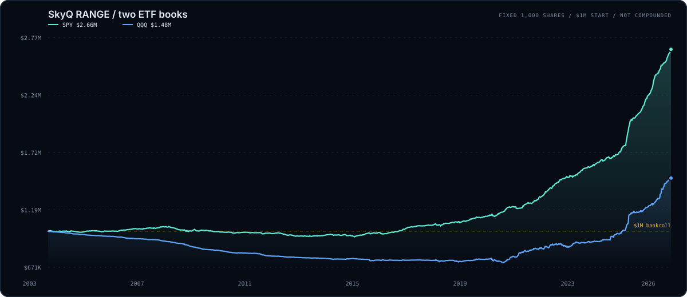
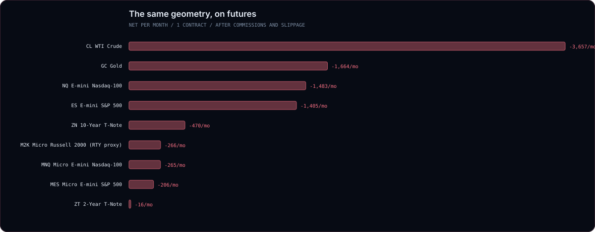

# SkyQ RANGE

**Two ETF books. One causal one-minute engine. A public, reproducible research record.**

SkyQ RANGE is the merged, standalone version of the former SPY and QQQ RANGE
repositories. It pairs a Python research/execution core with a PostgreSQL-backed
reporting model and a TypeScript control center. The strategy is a
mean-reversion channel scalper; the repository is deliberately honest about
where it works, where it fails, and what is not wired for live trading.

[](pyproject.toml)
[](LICENSE)
[](dashboard)
[](sql)



## The short answer

| Book | Trades | Win rate | Profit factor | Net P&L | Max drawdown | Net / month | Positive years |
|---|---:|---:|---:|---:|---:|---:|---:|
| **SPY** | 67,271 | 80.58% | 1.212 | **+$1,658,827.85** | -$95,845.60 | +$5,970.24 | 16 / 24 |
| **QQQ** | 32,356 | 75.44% | 1.114 | **+$484,445.10** | -$286,631.20 | +$1,743.55 | 8 / 24 |

Source: `data/published/range_metrics.csv`; the full canonical reports are the
`.txt` files in `reports/backtests/`. Window: 2003-09-10 through 2026-11-04,
regular hours, 1,000 shares, fixed size, both sides, one position at a time,
after modeled commissions and slippage. The table's net/month uses a calendar
month denominator; the canonical report's active-month figure is $5,971.47 for
SPY and $1,743.91 for QQQ. Same P&L, slightly different denominator.

> **The $1M is a measuring stick, not a bankroll.** Every result uses a fixed
> 1,000 shares and starts at $1,000,000 so gross and net dollars are comparable.
> The 165.9% SPY figure is **total** P&L on that fixed bankroll over roughly
> 23 years, not an annual return, not a CAGR, and not a compounded account.
> The equity curve retains profits as cash but never increases the share count.

QQQ is supported by the same engine but is the lower-quality book: profit factor
1.114, a 28.7% peak-to-trough drawdown and only 8 of 24 positive years. It is not
presented as equal to SPY. The `2007-2026` window is also available in the
dashboard and database for a common-start comparison.

## The cross-asset gate

The same entry/exit geometry was run unchanged on every futures series we have,
as a long-only, one-contract baseline with contract-specific tick values,
commissions and one tick of slippage:

| Symbol | Contract | Trades | Profit factor | Net | Net / month | Verdict |
|---|---|---:|---:|---:|---:|---|
| MES | Micro E-mini S&P 500 | 9,616 | 0.852 | -$18,498.84 | -$206.49 | negative after costs |
| MNQ | Micro E-mini Nasdaq-100 | 12,293 | 0.891 | -$23,712.32 | -$264.69 | negative after costs |
| M2K | Micro Russell 2000 (RTY proxy) | 13,767 | 0.753 | -$23,788.58 | -$265.54 | negative after costs |
| ZT | 2-Year T-Note | 90 | 0.600 | -$1,448.93 | -$16.17 | negative after costs |
| ES | E-mini S&P 500 | 9,411 | 0.896 | -$125,835.82 | -$1,404.64 | negative after costs |
| NQ | E-mini Nasdaq-100 | 12,203 | 0.937 | -$132,826.36 | -$1,482.67 | negative after costs |
| ZN | 10-Year T-Note | 1,874 | 0.563 | -$42,095.88 | -$469.89 | negative after costs |
| CL | WTI Crude | 20,035 | 0.754 | -$327,594.20 | -$3,656.75 | negative after costs |
| GC | Gold | 6,836 | 0.856 | -$149,074.32 | -$1,664.03 | negative after costs |



This is a **falsification record**, not a parameter search. It shows that the
published ETF geometry does not transfer as-is. `src/main.py` refuses every
futures symbol before opening a broker connection. See `reports/futures_gate.md`
and `scripts/research_futures.py`.

## What the strategy is

The engine builds a normalized-price channel, detects compression, and treats
the lower 20% of the channel as the long entry zone and the upper 20% as the
short entry zone. Both books trade both sides, one position at a time. A trade
targets 20% of the channel range, stops beyond the channel edge, and is flat by
15:55 New York. A channel that has become too thin relative to price is skipped.

| Preset | Stop | Channel floor | Max hold | Sizing |
|---|---:|---:|---:|---:|
| SPY | 100 ticks | 0.20% of price | 120 bars | 1,000 shares |
| QQQ | 150 ticks | 0.40% of price | 240 bars | 1,000 shares |

Everything is computed causally from completed 1-minute bars. The next bar's
open is the earliest possible fill. The backtest resolves a bar that touches both
the stop and target **stop-first**, which is the conservative assumption.

The full study, including the source audit and the parameter sensitivity, is in
[`RANGE_REPORT.md`](RANGE_REPORT.md). The short version is that the edge requires
a wide stop and a quiet, range-bound session; the high win rate is real, and so
is the negative skew on the losing tail.

## Repository map

```text
config/settings.py          instruments, causal constants, SPY/QQQ presets, risk guards
src/backtest.py             execution-aware backtester
src/strategy_logic.py       channel lifecycle and entry plans
src/main.py                 IBKR paper/live runner; SPY/QQQ only
src/models.py               SQLAlchemy schema
src/api.py                  FastAPI read model + safe local control
src/control.py              fixed paper-monitor start/stop (loopback only)
integrations/               IBKR, Alpaca paper, MT5, moomoo, Databento, LSE
scripts/                    research, seed, ledger loader, integration doctor
dashboard/                  React/Vite/TypeScript control center
sql/                        PostgreSQL DDL and analyst views
data/published/             committed metrics, equity, recent-trade sample
reports/                    canonical backtest reports and cross-asset gate
tests/                      strategy and API tests
```

## Quickstart

### 1. Python environment

Python 3.11–3.13 is supported; CI uses 3.12.

```bash
python -m venv .venv
# Windows: .venv\Scripts\activate
# macOS/Linux: source .venv/bin/activate
pip install -e ".[dev]"
```

### 2. Database

PostgreSQL is the production/reporting path. SQLite is a zero-config local
fallback:

```bash
cp .env.example .env
# SQLite:
DATABASE_URL=sqlite:///var/skyq_range.db python -m scripts.init_db

# PostgreSQL (create the database first):
psql -d skyq_range -f sql/001_schema.sql
psql -d skyq_range -f sql/002_views.sql
python -m scripts.init_db
```

`scripts.init_db` is idempotent and seeds instruments, the four book windows,
daily equity, a 500-row recent-trade sample and the futures gate. It does not read
any API key.

The committed sample is intentionally small. To load the full ~100,000-trade
ledgers into SQL:

```bash
python -m scripts.load_ledgers \
  --spy /path/to/skyq_range_spy_1000sh_2003_2026_trades.csv \
  --qqq /path/to/skyq_range_qqq_1000sh_2003_2026_trades.csv
```

Those ledger paths are outside this standalone repository. A public clone can
reproduce them from the source parquet data, or use the committed sample.

### 3. API and dashboard

```bash
cd dashboard
npm ci
npm run build
cd ..
python -m scripts.run_api
# http://127.0.0.1:8000/
# http://127.0.0.1:8000/docs
```

For frontend development, run the API on port 8000 and Vite on 5173:

```bash
cd dashboard
npm run dev
```

The Vite proxy sends `/api` to `127.0.0.1:8000`. The API serves the built Vite
dashboard from `dashboard/dist` when it exists.

The control center has four views: **Overview** (book selection, metrics, equity,
monthly P&L), **Trade tape** (recent closed trades, side filter, pagination),
**Research** (the complete futures rejection), and **System** (SQL counts,
adapter readiness and the paper-only control).

## Reproducing the books

The large parquet files are not committed. Put them outside Git (for example
`../../Data_For_Backtests/`) and pass `--data`:

```bash
python -m scripts.backtest_range --symbol SPY --quantity 1000 \
  --data ../../Data_For_Backtests/SPY_1m_24y.parquet \
  --start 2003-09-10 --end 2026-11-04

python -m scripts.backtest_range --symbol QQQ --quantity 1000 \
  --data ../../Data_For_Backtests/QQQ_1m_24y.parquet \
  --start 2003-09-10 --end 2026-11-04
```

The merged CLI applies the symbol preset automatically; do not pass SPY's stop,
floor or hold to QQQ. The canonical outputs are in `reports/backtests/`.

Regenerate the committed dashboard data after a run:

```bash
python -m scripts.build_published_data \
  --ledger-dir /path/to/ledgers \
  --comparison /path/to/etf_1000sh_comparison.csv
python -m scripts.init_db
```

`data/published/provenance.json` records the source ledger row counts and
SHA-256 hashes.

### Cross-asset research

The futures source data is external and not included. Point the script at the
directory containing `mes_1m.parquet`, `mnq_1m.parquet`, `rty_1m_indicators.parquet`,
`zt_1m.parquet`, etc.:

```bash
python -m scripts.research_futures \
  --data-root /path/to/futures/parquet \
  --symbols MES,MNQ,M2K,ZT,ES,NQ,ZN,CL,GC \
  --out reports
```

## Integrations and API keys

Copy `.env.example` to `.env`; `.env` is ignored by Git and must never be
committed. The application reads names only. `python -m scripts.check_integrations`
prints which adapters are configured and which local ports are listening,
without printing a secret.

| Integration | Role | Required environment names | Safety boundary |
|---|---|---|---|
| **IBKR** | Primary paper execution bridge | `IB_HOST`, `IB_PORT`, `IB_CLIENT_ID`, `IB_ACCOUNT` | Default paper Gateway `4002`; `--execute` is opt-in |
| **Alpaca** | Paper equity execution | `ALPACA_API_KEY`, `ALPACA_SECRET_KEY` | Adapter hard-codes the paper endpoint and never retries a POST |
| **MetaTrader 5** | Windows CFD/terminal bridge | `MT5_PATH`, `MT5_LOGIN`, `MT5_PASSWORD`, `MT5_SERVER` | Windows-only; use a demo account; imported lazily |
| **moomoo / Futu** | Read-only OpenD quotes | `MOOMOO_HOST`, `MOOMOO_PORT` | No API key in the repo; no order submission in the adapter |
| **Databento** | Historical 1-minute data | `DATABENTO_API_KEY`, `DATABENTO_DATASET` | Quote first; download refuses a quote over budget |
| **LSE** | Data vendor / archive + optional live feed | `LSE_API_KEY`, `LSE_WARMUP_DAYS` | **Not a broker**; execution still needs IBKR/Alpaca/MT5 |

### LSE in plain English

LSE is **London Strategic Edge**, a market-data vendor. Its `LSE_API_KEY` gives
you archive downloads and, with the live feed module, a tick stream. It does
**not** place trades. The included `integrations/lse.py` is the archive client
(`LseArchive`), and `integrations/lse_feed.py` contains the fuller optional live
feed adapted from the SkyQ Sigma S work. The archive client can request
`timeframe="1m"` for RANGE research data. The copied live socket builds
**5-minute** bars by default; it is a reference bridge, not a drop-in 1-minute
feed for this runner. The feed must be started before 09:30 New York because the
protocol does not replay a missed morning. The free WebSocket plan allows one
connection per key.

A forward test therefore has two parts:

1. Data: `LSE_API_KEY` plus `LseArchive` (1-minute history) or a validated
   1-minute live adapter. The included live feed is 5-minute and is not wired
   into `src/main.py`.
2. Execution: a broker adapter. The repository's live runner is IBKR paper by
default. It never routes orders through LSE.

### Databento

Install the optional client and quote a range before downloading:

```bash
pip install -e ".[databento]"
DATABENTO_API_KEY=... python -m scripts.check_integrations
```

The adapter exposes `quote()` and `download()`; `download` refuses a request whose
quoted cost exceeds the budget. Databento is a historical-data path, not a broker.

### IBKR / paper-first execution

```bash
# Monitor only; no orders.
python -m src.main --symbol SPY --port 4002

# Submit paper bracket orders after reviewing the plan.
python -m src.main --symbol SPY --port 4002 --execute
```

`src/main.py` rejects every non-SPY/QQQ symbol before connecting to the broker.
The repository's control API can start a **fixed paper monitor** only; it has no
order endpoint and is disabled unless `SKYQ_CONTROL_ENABLED=true`.

## SQL model

The reporting schema is intentionally normalized:

```text
instruments ──< backtest_runs ──< backtest_metrics
                      │
                      ├──< trades
                      └──< equity_points

futures_gate          (one row per tested symbol)
audit_events          (local control and seed actions)
```

`sql/002_views.sql` adds `v_range_metrics` and `v_trade_attribution` for analyst
queries. The API is a read model; the only mutation is the loopback-controlled
paper monitor.

Example:

```sql
SELECT symbol, trades, round(profit_factor::numeric, 3) AS pf,
       round(net::numeric, 2) AS net
FROM v_range_metrics
ORDER BY symbol, "window";
```

## Testing and CI

```bash
pytest -q
python -m scripts.check_integrations
cd dashboard && npm ci && npm run build
```

The GitHub Actions workflow runs the Python test suite and the TypeScript build
on every push and pull request. Tests use an isolated SQLite database and never
need broker credentials. Optional live integrations are marked as such and are
not exercised by CI.

## Regulation and risk notes (verified 2026-11-15)

**The old pattern-day-trader framework is being replaced, not simply
“abolished.”** FINRA Regulatory Notice 26-10 adopted amendments to Rule 4210
that replace the day-trading margin requirements in their entirety, including
the four-day-trades-in-five-business-days test and the $25,000 PDT minimum
equity requirement. The effective date is **June 4, 2026**. Member firms may
phase in implementation until **October 20, 2027**, and a broker may therefore
still apply the old rules during the transition.

The replacement is an **intraday margin** standard: firms determine an intraday
margin level and must require an intraday margin deficit to be satisfied promptly.
A margin account still has the general **$2,000 minimum** under Rule 4210 and
must satisfy maintenance margin; intraday losses can be liquidated by the broker.
This is a summary, not legal or tax advice. Confirm your broker's current policy
before relying on any rule.

- FINRA Regulatory Notice 26-10: <https://www.finra.org/rules-guidance/notices/26-10>
- FINRA investor explainer: <https://www.finra.org/investors/insights/intraday-margin-requirements>
- FINRA Rule 4210: <https://www.finra.org/rules-guidance/rulebooks/finra-rules/4210>

**Strategy risks.** The win rate is high because the target is small; the stop is
roughly several average wins. A cluster of stop-outs can erase a long run of
targets. The research equity curve is fixed-size and closed-trade only, so it
does not show intra-trade mark-to-market or overnight gap risk. Costs are modeled,
not guaranteed. Past results do not predict future returns. This repository is
research software, not investment advice.

## Security

- No API key, password, token, broker account number or `.env` file is committed.
- `.env` is ignored; `.env.example` contains names and placeholders only.
- The API never returns credential values; `/api/system` masks the database URL.
- Control endpoints are loopback-only, disabled by default, require an explicit
  header and optionally a token.
- The dashboard shows environment-variable **names**, not values.
- If a key was ever committed elsewhere, rotate it. Removing it from a working
  tree does not remove it from Git history.

See [SECURITY.md](SECURITY.md) for reporting and secret-handling guidance.

## Documentation

- [Architecture](docs/ARCHITECTURE.md)
- [Methodology and execution model](docs/METHODOLOGY.md)
- [Data and SQL](docs/DATA.md)
- [Integrations and credentials](docs/INTEGRATIONS.md)
- [Operations runbook](docs/OPERATIONS.md)
- [Risk and regulation](docs/RISK_AND_REGULATION.md)
- [Results and reproduction](docs/RESULTS.md)
- [Contributing](CONTRIBUTING.md)

## License

MIT. See [LICENSE](LICENSE). The code is published as a research and portfolio
artifact; it is not a solicitation or a promise of returns.
