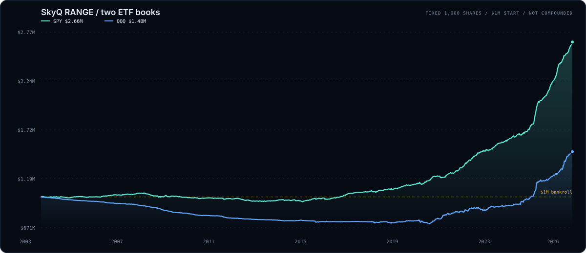

# Results

All figures are closed-trade, fixed 1,000 shares, after modeled commissions and
slippage. `return_pct` is total P&L divided by the $1,000,000 starting
measuring bankroll; it is **not** annual and **not** compounded.

## Both windows

| Symbol | Window | Trades | Win rate | Profit factor | Net | Total return* | Max drawdown | Net / month | Positive months | Positive years |
|---|---|---:|---:|---:|---:|---:|---:|---:|---:|---:|
| SPY | 2003–2026 | 67,271 | 80.58% | 1.212 | +$1,658,827.85 | 165.9% | -$95,845.60 | +$5,970.24 | 186 / 279 | 16 / 24 |
| QQQ | 2003–2026 | 32,356 | 75.44% | 1.114 | +$484,445.10 | 48.4% | -$286,631.20 | +$1,743.55 | 106 / 279 | 8 / 24 |
| SPY | 2007–2026 | 58,540 | 81.04% | 1.220 | +$1,636,604.45 | 163.7% | -$95,845.60 | +$6,874.71 | 164 / 239 | 14 / 20 |
| QQQ | 2007–2026 | 25,727 | 77.30% | 1.137 | +$553,775.90 | 55.4% | -$218,960.40 | +$2,326.19 | 105 / 239 | 8 / 20 |

\* On the fixed $1M measuring bankroll, not an annualized return. Net/month in
this table uses the published CSV's calendar-month denominator; the canonical
report's active-month figures are $5,971.47 (SPY) and $1,743.91 (QQQ).

The 2007–2026 window is the common 20-year start. QQQ is better in that window
than in the 2003 window, but it remains the weaker book: lower profit factor,
lower positive-year rate and a much larger drawdown relative to its net.

## MAD Edge risk and consistency metrics

| Metric | SPY | QQQ |
|---|---:|---:|
| Win rate | 80.58% | 75.44% |
| Reward/risk | 0.292 | 0.363 |
| Break-even win rate | 77.4% | 73.4% |
| Win-rate cushion | +3.2 pts | +2.1 pts |
| Profit factor | 1.212 | 1.114 |
| Sharpe (daily, annualized) | 2.53 | 0.92 |
| Sortino (daily, annualized) | 5.08 | 1.69 |
| Average planned risk | $1,230.25 | $1,723.91 |
| Max closed-trade drawdown | $95,845.60 | $286,631.20 |
| Positive months | 186 / 279 | 106 / 279 |
| Positive years | 16 / 24 | 8 / 24 |
| Exposure | 24.3% | 20.2% |
| Net / month (canonical active-month) | +$5,971.47 | +$1,743.91 |

Sortino is from the canonical report (`reports/backtests/*.txt`), not a new
calculation. Break-even is `1 / (1 + reward/risk)`. These figures describe the
same closed-trade, fixed-1,000-share study as the headline table.

## Equity



The SPY curve is the reference book. QQQ's path includes a long underwater period
in the middle of the sample; the terminal P&L alone hides that.

## Cross-asset gate

| Symbol | Description | Trades | Profit factor | Net | Net / month | Verdict |
|---|---|---:|---:|---:|---:|---|
| MES | Micro E-mini S&P 500 | 9,616 | 0.852 | -$18,498.84 | -$206.49 | negative after costs |
| MNQ | Micro E-mini Nasdaq-100 | 12,293 | 0.891 | -$23,712.32 | -$264.69 | negative after costs |
| M2K | Micro Russell 2000 (RTY proxy) | 13,767 | 0.753 | -$23,788.58 | -$265.54 | negative after costs |
| ZT | 2-Year T-Note | 90 | 0.600 | -$1,448.93 | -$16.17 | negative after costs |
| ES | E-mini S&P 500 | 9,411 | 0.896 | -$125,835.82 | -$1,404.64 | negative after costs |
| NQ | E-mini Nasdaq-100 | 12,203 | 0.937 | -$132,826.36 | -$1,482.67 | negative after costs |
| ZN | 10-Year T-Note | 1,874 | 0.563 | -$42,095.88 | -$469.89 | negative after costs |
| CL | WTI Crude | 20,035 | 0.754 | -$327,594.20 | -$3,656.75 | negative after costs |
| GC | Gold | 6,836 | 0.856 | -$149,074.32 | -$1,664.03 | negative after costs |
| YM | E-mini Dow | 7,313 | 0.916 | -$59,444.56 | -$729.05 | negative after costs |

No tested futures symbol clears the gate. This is evidence against a naive
cross-asset transfer; it is not a proof that no futures configuration could
work. The live runner blocks futures regardless.

## How to reproduce

```bash
python -m scripts.backtest_range --symbol SPY --quantity 1000 \
  --data /path/to/SPY_1m_24y.parquet \
  --start 2003-09-10 --end 2026-11-04
```

The attribution and one-factor sensitivity tables are in
[`ATTRIBUTION_AND_SENSITIVITY.md`](../reports/ATTRIBUTION_AND_SENSITIVITY.md),
with interpretation in [`ATTRIBUTION.md`](ATTRIBUTION.md).

The canonical reports are `reports/backtests/skyq_range_spy_1000sh_2003_2026.txt`
and the QQQ counterpart. The published CSV is generated from the canonical
ledgers; see `scripts/build_published_data.py`.

## Interpretation

- SPY has a positive full-history edge and a smaller drawdown; it is the stronger
  book.
- QQQ is positive in the full sample but inconsistent by year and materially
  weaker in profit factor and drawdown. It is not a second SPY.
- The edge is conditional: a high hit rate with a fat losing tail. The drawdown
  column, not the win rate, is the relevant risk statistic.
- Costs matter. The SPY full-history modeled cost is $820,070; a cheaper venue
  improves the result, a worse one degrades it.
- The common-start 2007 window changes QQQ's terminal figure but not the ranking.

See [METHODOLOGY.md](METHODOLOGY.md), [RISK_AND_REGULATION.md](RISK_AND_REGULATION.md)
and the full [`RANGE_REPORT.md`](../RANGE_REPORT.md).
